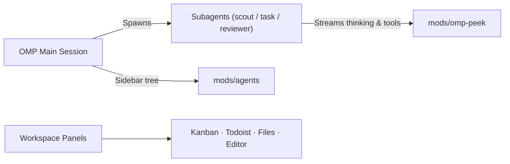

<h1 align="center">herdr-setup</h1>

<p align="center">
  <b>My personal <a href="https://herdr.dev">Herdr</a> setup — changes frequently.</b>
  <br>
  Custom GPUI mods, layout, keybindings, and live OMP subagent streaming.
</p>
<p align="center">
  
  
  
  
</p>

<br>

---
## Why Herdr?

This is my daily-driver [Herdr](https://herdr.dev) config. I tweak it constantly as my workflow evolves — mostly around running parallel [OMP](https://github.com/can1357/oh-my-pi) coding agents, streaming their subagents live without leaving the terminal, and keeping Kanban, Todoist, and file editing in one place.



- **Live Subagent Tree & Streaming Peek:** `mods/agents` renders a live subtree of active OMP subagents right under the parent session. Clicking any subagent opens `mods/omp-peek` — a read-only, chronological stream of its thinking, assistant output per turn, and tool calls without interrupting the main thread.
- **Built-in Productivity Panels:** `mods/kanban` auto-detects `.kanban/` boards per project, `mods/todoist` syncs active tasks, and `mods/files` + `mods/file-viewer` let you browse and edit files (`Ctrl+S`) without leaving Herdr.
- **Dedicated Customize Drawer:** `mods/herdr-omp` and `mods/customize-drawer` dock a bottom split drawer for tweaking Herdr or OMP configs on the fly, hidden cleanly from your main spaces.
- **Zero Lock-In:** Everything lives in plain JS (`gpui-kit` / `gpui-base`) and JSON inside `~/.config/herdr-app`.

<br>

---

## What's Inside

| Module / Config | Purpose |
| :--- | :--- |
| `settings.json` & `keys.json` | Dark appearance, `0.8` zoom, disabled ligatures, and custom keybindings |
| `layouts/custom.json` | Workspace layout with bottom `customize-drawer` split and right-side panels |
| `mods/omp-peek/` | Read-only live streaming overlay for OMP subagents (thinking, text, tool calls) |
| `mods/agents/` | Agents sidebar with live OMP subagent subtree and `Copy OMP session ID` |
| `mods/tabs/` | Top bar with auto-detected `Kanban`, `Todoist`, `Files`, and `Changes` toggles |
| `mods/kanban/` | Read-only `.kanban/` board panel; opens cards directly in `file-viewer` |
| `mods/todoist/` | Todoist API v1 active tasks panel (check-off, copy, quick-add via `.env`) |
| `mods/files/` & `mods/file-viewer/` | File tree with inline create/open and an editable main-tab viewer (`Ctrl+S`) |
| `mods/herdr-omp/` & `mods/customize-drawer/` | Sidebar dock and bottom split drawer for live Herdr/OMP customization |
| `mods/spaces/`, `mods/new-menu/`, `mods/toast/` | Workspace polish: hidden `__customize__` space, `oh-my-pi` first in `+` menu, clean toasts |

<br>

---

## Try It / Restore on a New Machine

No build step required. Launch [Herdr](https://herdr.dev) once so it initializes `~/.config/herdr-app`, then clone this repo into it:

```bash
# Close Herdr first, then initialize and pull this setup
cd ~/.config/herdr-app
git init
git remote add origin https://github.com/PramaAditya/herdr-setup.git
git fetch origin
git checkout -f main
```

### Optional Integrations

1. **Live Subagent Streaming (`omp-peek`):** Requires [OMP](https://github.com/can1357/oh-my-pi) with the `herdr-subagents` extension installed at `~/.omp/agent/extensions/herdr-subagents/` (writes live JSON state to `~/.omp/run/herdr-subagents/`).
2. **Todoist Panel:** Create `~/.config/herdr-app/.env` (gitignored) with your token:

```env
TODOIST_API_TOKEN=your_todoist_api_token_here
```

> **Note on Shipped Mods:** Herdr may move edited shipped mods (`tabs`, `agents`, `files`) to `<name>-edited` during app updates. If an update resets a shipped mod, check `git diff` and reapply.

<br>

---

<p align="center">
  <a href="https://herdr.dev">Herdr</a> · <a href="settings.json">Settings</a> · <a href="mods/omp-peek/main.js">OMP Peek Mod</a>
</p>
