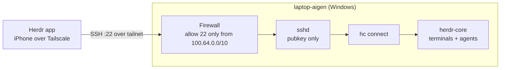

<h1 align="center">herdr-setup</h1>

<p align="center">
  <b>My personal <a href="https://herdr.dev">Herdr</a> setup — changes frequently.</b>
  <br>
  Custom GPUI mods, layout, keybindings, and OMP subagent integration.
</p>

<p align="center">
  
  
</p>

<br>

---

This is my daily-driver [Herdr](https://herdr.dev) config (`~/.config/herdr-app`). I tweak it constantly as my workflow evolves, so things here may change without notice.

## Restore on a New Machine

Launch [Herdr](https://herdr.dev) once so it initializes `~/.config/herdr-app`, close it, then pull this repo:

```bash
cd ~/.config/herdr-app
git init
git remote add origin https://github.com/PramaAditya/herdr-setup.git
git fetch origin
git checkout -f main
```

- **Todoist panel (optional):** create `~/.config/herdr-app/.env` with `TODOIST_API_TOKEN=...`
- **OMP subagent peek (optional):** requires the `herdr-subagents` extension in `~/.omp/agent/extensions/herdr-subagents/`

> **Note on Shipped Mods:** Herdr may move edited shipped mods to `<name>-edited` on app updates. Check `git diff` and reapply if needed.

## Remote from a Phone (Windows + Tailscale)

The [Herdr mobile app](https://herdr.dev/mobile/) talks to `herdr-core` over SSH — no account, nothing in between. On Windows, Tailscale is only the *transport*: its SSH server exists on Linux/macOS alone, so Windows needs its own OpenSSH Server.



| Piece | Setting used here |
|---|---|
| Network | Tailscale on both devices; MagicDNS name `laptop-aigen.<tailnet>.ts.net` |
| Exposed port | `22` inbound, source limited to `100.64.0.0/10` (tailnet only, not LAN/public) |
| Auth | ed25519 pubkey only; `PasswordAuthentication no`, `KbdInteractiveAuthentication no` |
| Key location | `C:\ProgramData\ssh\administrators_authorized_keys` — the account is an Administrators member, so `~/.ssh/authorized_keys` is ignored |
| sshd service | Automatic, restart-on-failure, binds `0.0.0.0` (binding to the Tailscale IP breaks the boot race) |

**1. Tailscale** (elevated PowerShell; the CLI is not on PATH by default — add `C:\Program Files\Tailscale` to it):

```powershell
winget install --id Tailscale.Tailscale -e --accept-package-agreements --accept-source-agreements
tailscale up
```

**2. OpenSSH Server + firewall + recovery**

```powershell
Add-WindowsCapability -Online -Name OpenSSH.Server~~~~0.0.1.0
Set-Service -Name sshd -StartupType Automatic
Start-Service sshd
Remove-NetFirewallRule -Name 'OpenSSH-Server-In-TCP' -ErrorAction SilentlyContinue
New-NetFirewallRule -Name 'sshd-tailnet' -DisplayName 'OpenSSH over Tailscale' `
  -Direction Inbound -Protocol TCP -LocalPort 22 -RemoteAddress 100.64.0.0/10 `
  -Action Allow -Profile Any
sc.exe failure sshd reset= 86400 actions= restart/5000/restart/10000/restart/30000
```

If `Add-WindowsCapability` hangs, check `C:\Windows\Logs\CBS\CBS.log` — it downloads ~85 MB from Windows Update. If it aborts partway, `sshd.exe` may exist while `C:\ProgramData\ssh\sshd_config` is missing; seed it from `C:\Windows\System32\OpenSSH\sshd_config_default`.

**3. sshd_config** — keep the shipped `Match Group administrators` block, then add:

```
PasswordAuthentication no
KbdInteractiveAuthentication no
PubkeyAuthentication yes
```

**4. Public key from the app** — the app generates its own key and shows a Unix one-liner; on Windows the target is different. Add the line from the app (no elevation needed once ACLs are set):

```powershell
Add-Content "$env:ProgramData\ssh\administrators_authorized_keys" "ssh-ed25519 AAAA... herdr-mobile"
```

One-time ACL (elevated), so sshd accepts the file and later appends need no elevation:

```powershell
icacls "$env:ProgramData\ssh\administrators_authorized_keys" /inheritance:r `
  /grant "SYSTEM:F" /grant "Administrators:F" /grant "$env:COMPUTERNAME\$env:USERNAME:F"
```

**5. Verify before touching the phone**

```powershell
ssh <user>@$(tailscale ip -4) "hc --version"
```

Then in the app: **Add machine** → address = the MagicDNS name or `100.x` IP, user, port `22`.

| Symptom | Cause |
|---|---|
| Key accepted on Linux, rejected here | Administrators members read `administrators_authorized_keys`, not `~/.ssh/authorized_keys`; the file must be one line with the ACL above |
| `hc: command not found` over SSH | herdr-core's folder missing from PATH, or sshd not restarted after the PATH change |
| Phone resolves nothing | MagicDNS off, or "Use Tailscale DNS" off on the phone; the `100.x` IP always works |
| Connects, Inbox empty | herdr-core not running: open Herdr on the PC or `hc server start` (agents are not restored after a reboot) |
| `tailscale set --ssh` does nothing | Tailscale SSH server is Linux/macOS only |
